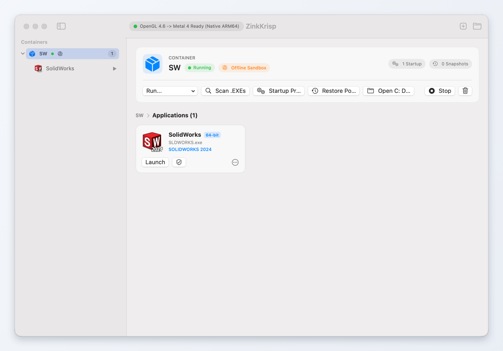
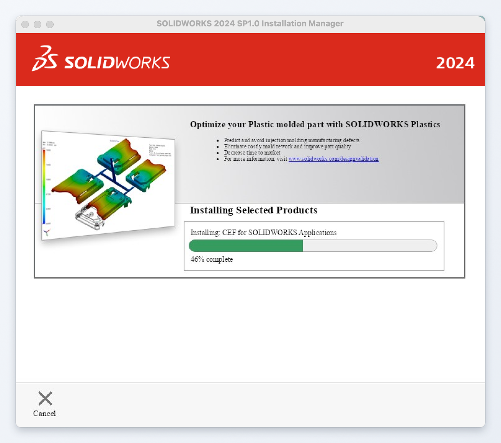
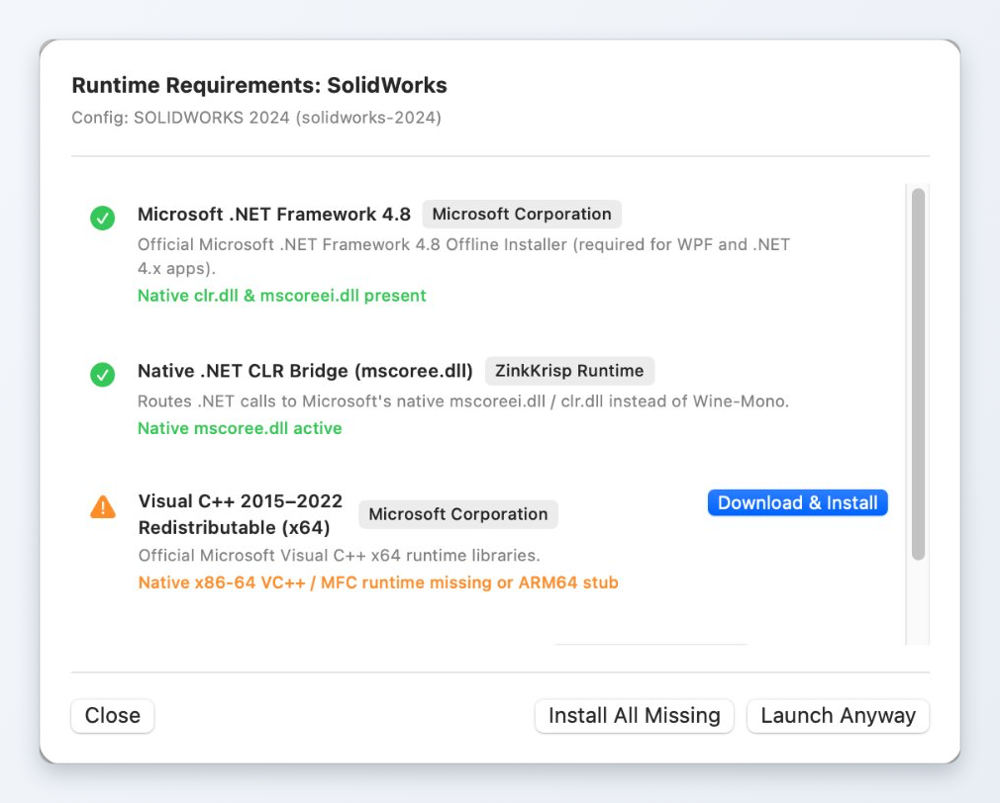

# ZinkKrisp

[](https://muradjabir.com/blog/post-rosetta-opengl-apple-silicon)
[](https://www.gnu.org/licenses/agpl-3.0)
[-black?style=for-the-badge&logo=apple)](https://muradjabir.com/blog/post-rosetta-opengl-apple-silicon)

> **Engineering Deep-Dive:**  
> **[Post-Rosetta OpenGL 4.6 on Apple Silicon: Bridging x86_64 Windows Applications to Native ARM64 Metal via FEX, ARM64EC Zink, and KosmicKrisp](https://muradjabir.com/blog/post-rosetta-opengl-apple-silicon)**

**Run `x86_64` Windows OpenGL 4.6 CAD and desktop apps natively on Apple Silicon Macs — powered by ARM64EC Mesa Zink and Apple Metal via KosmicKrisp, with no virtual machine and no Rosetta 2 on the 3D graphics pipeline.**



---

## Getting Started

### 1. What You Need
- An **Apple Silicon Mac** (`M1` – `M4` series) running **macOS 14.0 (Sonoma) or newer**
- **[MetalSharp-Wine](https://github.com/MetalSharp/MetalSharp-Wine)** installed in `/Applications` (or chosen on first launch) — ZinkKrisp uses this external Wine + FEX ARM64EC runtime and does not bundle it
- Your own **Windows installer** (`.exe`, `.msi`, or `.zip`) and a valid software license where required

### 2. Install ZinkKrisp
1. Download the latest `ZinkKrisp-*-macos-arm64.zip` from [Releases](../../releases), unzip it, and drag **`ZinkKrisp.app`** into `/Applications`.
2. Because release builds are ad-hoc signed, clear the quarantine attribute before opening if macOS Gatekeeper warns that the app is damaged or from an unidentified developer:
   ```bash
   xattr -cr /Applications/ZinkKrisp.app
   ```
3. Open **ZinkKrisp** from `/Applications`. On first launch, ZinkKrisp detects `MetalSharp-Wine` and initializes a clean template Windows environment.

### 3. Create a Container & Install a Windows App
Each Windows application gets its own isolated container cloned instantaneously via APFS Copy-on-Write:
1. Click **`+`** in the toolbar (or drag a Windows `.exe`, `.msi`, or `.zip` directly onto the ZinkKrisp window).
2. Name your container and select your Windows installer. If the application has a built-in profile (such as `SOLIDWORKS Installation Manager`), ZinkKrisp checks and offers any required runtimes automatically.
3. Follow the Windows installer UI — ZinkKrisp's built-in WebView2 bridge renders modern Chromium-based installers inside Wine windows cleanly on macOS.



### 4. Install Runtime Prerequisites (When Prompted)
Many Windows CAD and desktop apps require `.NET Framework 4.8`, `Visual C++ 2015–2022 Redistributable`, or `Microsoft Edge WebView2`.

When you click **Requirements** (shield icon) or launch an app with missing runtimes, ZinkKrisp shows a guided checklist and downloads official Microsoft installers on demand — nothing proprietary is bundled inside `ZinkKrisp.app`:



Click **Install All Missing** once, and ZinkKrisp handles the `.NET` CLR forwarding bridge, native `x86-64` VC++/MFC runtime extraction, and 64-bit COM repairs automatically.

### 5. Launch Anywhere
- Click **Launch** inside ZinkKrisp, or open the generated native macOS wrapper bundle in `~/Applications/` directly from **Spotlight** or **Launchpad**.
- Use the app's **Settings** (`...` button) to toggle **Retina 2x**, **CAD Wireframe Fast Path**, **Metal HUD** (real-time FPS & frame times), or per-app environment variables and DLL overrides.

---

## Key Features for Users

- **Container → Application Hierarchy**: Keep apps cleanly separated in their own Windows `C:` drives while running related tools and background daemons inside the same container.
- **Instant APFS Restore Points**: Save a sub-second snapshot before/after installing updates or prerequisites, and roll back cleanly if anything goes wrong.
- **Per-Container Offline Sandbox**: Toggle **Offline Sandbox** to block external network access for a container while keeping `localhost` loopback (such as local license servers) working.
- **Background Startup Processes**: Automatically start required local services (for example, `lmgrd` license daemons) before an app launches without spawning duplicates.
- **Zero-VM Performance**: Runs the Windows `x86_64` app through FEX ARM64EC JIT and renders OpenGL 4.6 directly onto Apple Metal via Zink + KosmicKrisp with persistent shader caching.

---

## Compatibility List & Reporting Issues

Looking to see what works, or hit a bug in a specific Windows app?

- Check [`compatibility.csv`](compatibility.csv) for tested applications, status ratings (`platinum` through `borked`/`untested`), required prerequisites, and known issues.
- Read [`COMPATIBILITY.md`](COMPATIBILITY.md) for status definitions and how to reference a **Software ID** (e.g., `solidworks-2024`).
- Open a GitHub Issue using our structured templates:
  - [**Software Compatibility Issue**](.github/ISSUE_TEMPLATE/software_issue.yml) — report a crash, rendering glitch, or setup failure (please include the canonical Software ID, chip, macOS version, and logs).
  - [**Compatibility List Update / New Software Report**](.github/ISSUE_TEMPLATE/compatibility_report.yml) — submit a new app or update a status rating.

---

## Quick Troubleshooting

- **"ZinkKrisp is damaged and can't be opened" / Gatekeeper block**: Run `xattr -cr /Applications/ZinkKrisp.app` once in Terminal, or right-click → **Open**.
- **Where are my Windows files and containers stored?**: Everything lives under `~/Library/Application Support/ZinkKrisp/Containers/<ContainerName>/drive_c/`. You can also click **Open C: Drive** directly in ZinkKrisp.
- **"Failed to initialize .NET Framework" or missing VC++ DLL errors**: Click the **Requirements** (shield) icon on the app card and run **Install All Missing** to repair `.NET 4.8`, `mscoree_shim64.dll`, and native `x86-64` VC++ runtimes.
- **"MetalSharp-Wine not found"**: Install [MetalSharp-Wine](https://github.com/MetalSharp/MetalSharp-Wine) first, then pick `MetalSharp-Wine.app` when ZinkKrisp prompts you.

---

<details>
<summary><strong>For Developers & Power Users: Architecture, CLI (`gl46-mac`), Env Toggles & Building from Source</strong></summary>

### Architecture

```text
Windows x86_64 App (.exe)
   └─ FEX ARM64EC JIT (libarm64ecfex.dll via MetalSharp-Wine)
         └─ Native COFF-ARM64EC opengl32.dll + libgallium_wgl.dll (Mesa Zink)
               └─ Wine winevulkan thunk (guest ARM64EC → host arm64)
                     └─ Native macOS arm64 libvulkan_kosmickrisp.dylib (Mesa KosmicKrisp)
                           └─ Apple Metal (CAMetalLayer + MTLDevice)
```

- **Bridge & Overlay Layer** ([`src/webview_bridge/`](src/webview_bridge), [architecture notes](WEBVIEW2_WINE_ARCHITECTURE.md)): CDP screencast shared-memory overlay (`zk_webview_bridge.py` + `zk_webview_overlay.cpp`), IAT `SendMessageTimeout` DeadlockGuard (`zk_webview_bridge.c` + `version_proxy.c`), and dynamic ordinal-preserving CLR shim (`mscoree_shim.c` + `mscoree_shim.def`).
- **Mesa Patches** ([`patches/mesa_kosmickrisp_zink.patch`](patches/mesa_kosmickrisp_zink.patch)): `__arm64ec__` arch detection, `EXT_custom_border_color`, `EXT_border_color_swizzle`, runtime `smoothLines` toggle, host shader cache (`~/.cache/mesa_shader_cache_db`), texel-blocksize view clamp (`KK_CLAMP_VIEW_MISMATCH`), and `B8G8R8A8_UNORM` swapchain fallback sync.

### CLI Usage (`gl46-mac`)

If you prefer the standalone runtime tarball (`zink-kk-macos-arm64ec-*.tar.gz`) without the GUI app:

```bash
./gl46-mac install --prefix ~/.wine-cad --profile cad-workstation
./gl46-mac wrap --prefix ~/.wine-cad --exe "C:\Path\To\YourApp.exe" --name "My CAD App" --profile cad-workstation
```

### Runtime Environment Toggles

| Variable | Default | Purpose |
| --- | --- | --- |
| `KK_SPOOF_SMOOTH_LINES` | `1` | Reports `smoothLines = true` to avoid expensive line geometry shaders in CAD viewports. |
| `KK_CLAMP_VIEW_MISMATCH` | `1` | Clamps mismatched `VkImage`/`VkImageView` texel block sizes in `kk_image_view_init`. |
| `ZINKKRISP_HUD` / `SWONMAC_HUD` | `0` | Enables `MTL_HUD_ENABLED=1` (Apple Metal FPS, frame time, GPU ms overlay). |
| `FEX_TSOENABLED` | `0` | Disables strict x86 TSO memory ordering barriers for higher throughput under FEX ARM64EC. |
| `mesa_glthread` | `true` | Enables Mesa GL command threading inside Zink. |

### Building from Source

- **Mesa + KosmicKrisp + Zink**: See [`.github/workflows/build.yml`](.github/workflows/build.yml) and `./scripts/package-release.sh`.
- **WebView2 & `.NET` Bridges**: Run `./src/webview_bridge/build.sh` (requires `mingw-w64`).
- **ZinkKrisp macOS App**: Run `./app/ZinkKrisp/build_app_bundle.sh` on Apple Silicon macOS 14+ with Xcode / Swift toolchain.

</details>

---

## License

* **ZinkKrisp Application, Scripts, & Build Tooling:** Licensed under the **GNU Affero General Public License v3.0 (`AGPL-3.0-only`)**. Any fork, derivative work, or application incorporating this code must be distributed in full source form under the same `AGPL-3.0` license. See [LICENSE](LICENSE).
* **Mesa 3D Patches & Pre-built Driver Binaries (`opengl32.dll`, `libgallium_wgl.dll`, `libvulkan_kosmickrisp.dylib`):** Derived from [Mesa 3D](https://www.mesa3d.org/) and licensed under the **MIT License**. See [app/ZinkKrisp/Payload/THIRD_PARTY_LICENSES.txt](app/ZinkKrisp/Payload/THIRD_PARTY_LICENSES.txt) for full copyright notices and third-party license texts.

Copyright © 2026 Murad Jabir. All rights reserved.

---

## Trademark & Licensing Disclaimer

ZinkKrisp is an independent open-source project and is not affiliated with, sponsored by, or endorsed by Dassault Systèmes, Microsoft Corporation, Apple Inc., or any listed software vendor. All trademarks and product names belong to their respective owners. Users are responsible for supplying their own valid software licenses and official installers.
